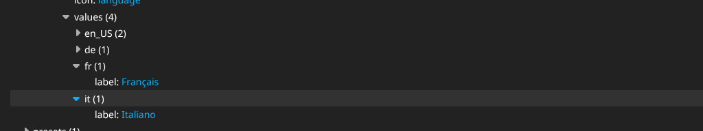
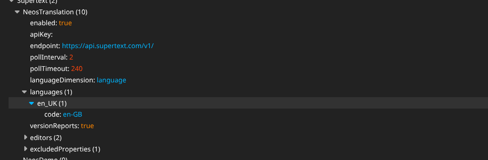
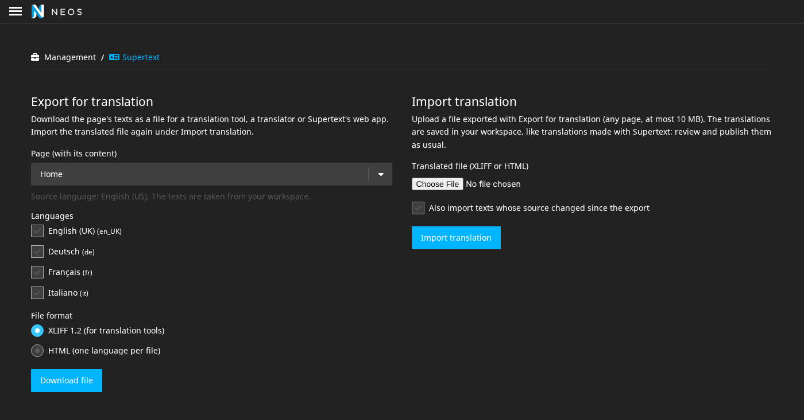

# Installation guide — Supertext Translation for Neos

For administrators setting up the package on a Neos site.

> **Just want to try it?** `demo/` contains a ready-to-run container with Neos 9.1, the Neos demo site in English and German plus empty French and Italian, and this package installed. It also runs the public Supertext demo. See the *Demo* section of the [developer guide](DEVELOPER.md#demo-railway).

## Requirements

| | |
| --- | --- |
| Neos | 9.0 or newer (developed and tested on 9.1) |
| PHP | 8.2 or newer, with `ext-dom` |
| Content dimensions | A language dimension (named `language` by default) |
| Supertext | An account ([create one or log in](https://www.supertext.com/person/en/account/signin)) with an API key ([supertext.com → Integrations → API](https://www.supertext.com/en/integrations/api), requires the Admin role) |
| Network | The web server must reach `https://api.supertext.com` over HTTPS (and, while *Send version information to Supertext* is on, `https://commandocenter-production.up.railway.app`) |

## 1. Add the package

The package is not on Packagist yet. Add the GitHub repository to your project's `composer.json`, then require it (it brings the [Supertext SDK](https://github.com/Supertext/Supertext-API-SDK-and-Guide) and Supertext Plugin Health it uses with it; there is nothing else to install):

```bash
composer config repositories.supertext-neos vcs https://github.com/Supertext/Neos-Supertext-Translation
composer require supertext/neos-translation:dev-main
./flow flow:cache:flush
```

If the repository is private, Composer needs a GitHub token with read access (`composer config --global github-oauth.github.com <token>`).

Nothing to activate: the package registers itself (a content repository command hook and an HTTP middleware) for every content repository based on Neos' `default` preset.

## 2. Set the API key

Get the key first:

1. **No Supertext account yet?** [Create one at supertext.com](https://www.supertext.com/person/en/account/signin) (the same page logs you in if you already have one).
2. **Generate your API key** at [supertext.com → Integrations → API](https://www.supertext.com/en/integrations/api). This requires the **Admin** role in your Supertext account; ask your account admin otherwise.

Then set it, either:

- **Environment variable (recommended):** `SUPERTEXT_API_KEY=...` for the web server and CLI. It wins over the setting and keeps the key out of the repository.
- **Setting:** in your site package or `Configuration/Settings.yaml`:

  ```yaml
  Supertext:
    NeosTranslation:
      apiKey: '...'
  ```

Supertext shows the key as `Supertext-Auth-Key <key>`; you can paste it with or without that prefix.

Check it:

```bash
./flow supertext:check
```

```text
Supertext Translation for Neos 0.1.0
Endpoint: https://api.supertext.com/v1/

Languages (dimension value → Supertext code):
  en_US → en-US
  en_UK → en-GB
  de → de-CH (more)
  fr → fr-CH (more)
  it → it-CH (more)

API key checked: the connection to Supertext works. (2026-10-14T08:00:00Z)

Version information to Supertext: on
Site URL: https://www.example.ch
Ping endpoint: https://www.example.ch/supertext/ping
Check report: sent
```

The first line is the installed package version, read from Composer (`dev-main` if you installed the branch). Include it when you report a problem. Then come the languages (see *3. Languages*), the result of the API key check with its time (Supertext's cost-free `features` call: nothing is translated or billed) and the version information (see *5. Version information and the API key check*). The command exits with 1 when the key doesn't work or a language has no Supertext code.

If the key is wrong, it says *Supertext rejected the API key* (or *No API key is set yet*), with the links to create a Supertext account and generate a key.

## 3. Languages

The package translates whenever a page or content element is created in another value of the **language dimension**. Every dimension value needs a **Supertext language**: Supertext accepts only its own codes (see *Supertext language codes* below). You choose them in the back end under **Administration → Supertext** (administrators only):


- One row per value of the language dimension (all content repositories, the source language included: one mapping serves both directions), with its label and value (e.g. *Deutsch (de)*), a combo box with Supertext's languages (*German (Switzerland) (de-CH)*, names in your interface language) and, for the languages that offer one, the **form of address** (*Default*, *Formal*, *Informal*).
- **Preselected** is Supertext's suggestion where one is obvious: a value that already **is** a Supertext code, apart from upper/lower case and `_`/`-` (`en_US` → `en-US`, `es` → `es`, `de_CH` → `de-CH`), else the default (`de` → `de-DE`, `en` → `en-US`, `fr` → `fr-FR`, `it` → `it-IT`, `pt` → `pt-PT`, `zh` → `zh-Hans`, `sr` → `sr-Latn`, `zh_TW` → `zh-Hant`, a region of a bare code → the bare code: `es_ES` → `es`, `nl_NL` → `nl`). A language nobody chose is translated with that suggestion, so most sites need no setup. Choose another variant where you want one, e.g. `de` → *German (Switzerland)*.
- A value **without a suggestion** (`en_UK`, `en_IE`, `de_LI`, `gsw`, …) shows *— choose —*. Until you choose, translating into or from that language stops before anything is sent, with *The language en_UK has no Supertext language yet. Ask your administrator to choose one under Administration → Supertext (or to set Supertext.NeosTranslation.languages.en_UK.code in Settings.yaml, e.g. 'de-CH').*
- **Save** checks every choice against Supertext's list. The choices are stored in the persistent Flow cache `Supertext_NeosTranslation_State` (`Data/Persistent/Cache`, not emptied by `flow:cache:flush`; with several web servers give it a shared backend, see *5. Version information*).

The same mapping is used when the language is the source: `de-CH` is sent as source `de` (sources have no region).

**Override in Settings.yaml** (for automated setups): `languages.<value>.code` and `languages.<value>.politeness` win over the module for the languages they name; the module shows them read-only with the setting's name. `enabled: false` (Settings.yaml only) never translates into a language.

```yaml
Supertext:
  NeosTranslation:
    languages:
      de:
        code: 'de-CH'        # Supertext code (see the list below)
        politeness: 'more'   # more = formal (Sie/vous/Lei), less = informal (du/tu/tu)
      en_UK:
        code: 'en-GB'
        enabled: false       # never translate into this language
```

`./flow supertext:check` lists every dimension value with the code it is translated with, and *not mapped* for the ones that still need a choice.

**Form of address** (`politeness`) is only offered for some targets: not for `en-GB`, `en-US`, `gsw-u-sd-chbe`, `gsw-u-sd-chzh`, `rm`, `sq`, `sr-Cyrl` and `sr-Latn`. The module shows it only for the others and stores *Default* otherwise. A tone set in Settings.yaml is sent as it is; for those targets Supertext refuses the translation (*Supertext offers no formal or informal tone for this language. Set it to the default tone (…politeness: 'default').*), and `supertext:check` warns about it beforehand.

### Supertext language codes

As offered by the Supertext API in October 2026 (the bundled SDK's `Languages::TARGETS`):

| Language | Target code(s) |
| --- | --- |
| German | `de-CH`, `de-DE`, `de-AT` |
| English | `en-US`, `en-GB` |
| French | `fr-CH`, `fr-FR` |
| Italian | `it-CH`, `it-IT` |
| Portuguese | `pt-PT`, `pt-BR` |
| Chinese | `zh-Hans` (simplified), `zh-Hant` (traditional) |
| Serbian | `sr-Latn`, `sr-Cyrl` |
| Swiss German | `gsw-u-sd-chzh` (Zurich), `gsw-u-sd-chbe` (Bern) |
| All others, without region | `bg`, `cs`, `da`, `el`, `es`, `fi`, `hr`, `hu`, `ja`, `ko`, `nb`, `nl`, `pl`, `rm`, `ru`, `sk`, `sl`, `sq`, `sv`, `tr` |

Sources are bare languages (`en`, `de`, `fr`, …). Regional codes for the other languages (`es-ES`, `sl-SI`, `zh-CN`) are **not** accepted. A code Supertext adds later can be set in Settings.yaml right away (codes there are sent as they are); the module's combo boxes offer the codes of the bundled SDK.

Regional variants of the same language (e.g. `en_US` → `en_UK`) are never translated.

The languages themselves are Neos content dimensions (`Neos.ContentRepositoryRegistry.contentRepositories.<id>.contentDimensions.language`). If you **add a language to a site that already has content**, extend the root node to it once, or Neos can't create pages in it ("Root Node Aggregates cannot be varied"). The demo does this with a node migration (`demo/DistributionPackages/Supertext.NeosDemo/Migrations/ContentRepository/`) and `./flow nodemigration:execute <version>`.

You can check the active configuration in the backend under **Administration › Configuration › Settings**, for the languages:



and for this package (the settings only; choices made under Administration → Supertext aren't settings):



### Interface languages

For translating, editors use Neos' own *Create and copy* dialog, which follows each user's Neos interface language (user menu → *User Settings* → *Interface Language*), English, German, French and Italian included. The package's screens, **Management → Supertext** (export and import of translation files) and **Administration → Supertext** (languages), come in the same four languages and follow the same setting (`Resources/Private/Translations/{en,de,fr,it}/Main.xlf`). Text for administrators only, the output of the `supertext:*` CLI commands, the `X-Supertext-Error` response header and log lines, is in English.


## 4. Check it works

Open a page in the backend, switch the language menu to a language the page doesn't exist in yet, and choose **Create and copy** — the page appears translated after a few seconds (see the [user guide](USER_GUIDE.md)). Or from the CLI:

```bash
./flow supertext:translate --node <page node id> --language fr --workspace user-<yourname>
```

### Translation files (export and import)

Export for translation and import of translated files (XLIFF 1.2 or HTML, see the [user guide](USER_GUIDE.md#translation-files-export-and-import-xliff-or-html)) need nothing to configure and no API key: they never call the Supertext API.



- **Back-end module Management → Supertext:** for editors. Access is the privilege target `Supertext.NeosTranslation:Module.TranslationFiles` (module) with `Supertext.NeosTranslation:Module.TranslationFiles.Actions` (its actions), granted to `Neos.Neos:Editor` and so to administrators. To give it to another role (e.g. `Neos.Neos:RestrictedEditor`) or take it away, grant or deny both in your own `Policy.yaml`; to hide the module everywhere, set `Neos.Neos.modules.management.submodules.supertext.enabled: false`. The module **works in the user's personal workspace**: export reads the texts from it (live plus the user's unpublished changes) and import writes into it, so imported translations are reviewed and published in the Neos UI like any other change (a personal workspace that doesn't exist yet is created, as at login). Uploads are read in memory and never stored; files larger than 10 MB are refused before they are read (PHP's `upload_max_filesize` and `post_max_size` must allow 10 MB for that message to appear; the demo uses 32 MB). Forms are protected by Flow's CSRF token.
- **CLI** `./flow supertext:export` and `./flow supertext:import`: for administrators and scripts. Like `supertext:translate` they run on the server's command line without Neos authorization checks, so whoever may run `./flow` may export and import. The import writes to the workspace given with `--workspace` (default `live`, which publishes immediately; use a user workspace such as `user-<name>` to review first).

## 5. Version information and the API key check

**Send version information to Supertext** (`versionReports`) is on by default. The package then sends the site URL and the versions of this package, Neos and PHP to Supertext after an update and when the API key changes, so Supertext support can see which version you run. A report contains exactly: the site URL, the package's name (`Neos-Supertext-Translation`) and version, the Neos and PHP versions, the bundled Supertext SDK's version, whether a key is set, the result of the API key check below (status, time, HTTP status, Supertext's error code) and the address of the ping endpoint. **No content, no API key and no personal data are sent.**

- **When:** on requests to the Neos back end (`/neos…`) and on `supertext:translate`, when something changed since the last report: first use (`installed`), a new package, Neos or PHP version (`upgraded`), a new key check result (`api_key_check`). Usually there is nothing to do and nothing is sent. `supertext:check` always sends a `check` report. Front-end page views never report.
- Reports go from the Neos server, never from the browser. A report waits at most 3 seconds; one that fails is not retried for an hour and never breaks a request or a translation.
- **Site URL:** `Neos.Flow.http.baseUri` if set, else the primary domain of the default site, else the address the Neos back end was last opened on (remembered for the CLI). Until one is known, nothing is reported (`supertext:check` says so).
- **Turn it off** with `versionReports: false` in your Settings.yaml, or `SUPERTEXT_VERSION_REPORTS=0` in the environment (it wins over the setting; `1` turns it on). Then nothing is sent at all and the ping endpoint answers 404.

**The API key check** runs whether or not version information is sent: when the package runs with a key it hasn't checked yet (compared by a SHA-256 fingerprint kept locally, never the key itself), on `supertext:check`, and when Supertext rejects the key during a translation. It's Supertext's cost-free `features` call; nothing is translated or billed. `supertext:check` shows the latest result with its time.

**The ping endpoint** `GET <site URL>/supertext/ping?challenge=…` is public (no login, no session, not cached) and answers only `{"ok":true,"plugin":"Neos-Supertext-Translation","challenge":"…"}`, so Supertext can see that the site is reachable from the internet. It returns nothing else: no versions, no settings, no data. If a page of your site has the path `supertext/ping`, it is hidden by this endpoint.

The state of the reports and the last key check (and the languages chosen under Administration → Supertext) are kept in the persistent Flow cache `Supertext_NeosTranslation_State` (`Data/Persistent/Cache`, not emptied by `flow:cache:flush`). With several web servers, give that cache a shared backend in `Configuration/Caches.yaml` (e.g. `Neos\Cache\Backend\PdoBackend`), or each server reports for itself.

## All settings

All under `Supertext.NeosTranslation`:

| Setting | Default | |
| --- | --- | --- |
| `enabled` | `true` | Translate automatically when nodes are created in another language |
| `apiKey` | `''` | API key; `SUPERTEXT_API_KEY` wins |
| `endpoint` | `https://api.supertext.com/v1/` | API base URL; `SUPERTEXT_API_ENDPOINT` wins |
| `pollInterval` | `2` | Seconds between status checks |
| `pollTimeout` | `240` | Maximum seconds to wait for one document |
| `languageDimension` | `language` | Name of the language dimension |
| `languages.<value>.code` | none: the choice under Administration → Supertext, else Supertext's suggestion | Overrides the language mapping for this dimension value: Supertext code (as target; as source without region). Shown read-only in the module; see *3. Languages* |
| `languages.<value>.politeness` | none: the choice under Administration → Supertext, else `default` | Overrides the form of address: `more` (formal), `less` (informal) or `default`; only for targets that offer a tone |
| `languages.<value>.enabled` | `true` | `false` never translates into that language |
| `versionReports` | `true` | *Send version information to Supertext*: sends the site URL and the versions of this plugin, Neos and PHP to Supertext after an update and when the API key changes, so Supertext support can see which version you run. No content, no API key and no personal data are sent. `SUPERTEXT_VERSION_REPORTS` (`0`/`1`) wins. See *5. Version information and the API key check* |
| `editors.plainText` | TextField, TextArea editors | Inspector editors whose string properties are translated as plain text |
| `editors.richText` | RichTextEditor | Inspector editors whose properties are translated as HTML |
| `excludedProperties` | `[uriPathSegment]` | Never translated (the URL segment is rebuilt from the translated title) |

Outside `Supertext.NeosTranslation`:

| Setting | Default | |
| --- | --- | --- |
| `Neos.Neos.modules.management.submodules.supertext.enabled` | `true` | `false` hides the back-end module **Management → Supertext** (export and import of translation files) for everyone; who sees it otherwise is set in `Policy.yaml` (see *Translation files* above) |
| `Neos.Neos.modules.administration.submodules.supertext.enabled` | `true` | `false` hides the back-end module **Administration → Supertext** (languages); Settings.yaml's `languages` still apply. Access: privilege targets `Supertext.NeosTranslation:Module.LanguageMapping` and `…LanguageMapping.Actions`, granted to `Neos.Neos:Administrator` |

**Per property** (in a NodeTypes YAML file) you can force a property in or out:

```yaml
'Vendor.Site:Content.Teaser':
  properties:
    internalNote:
      options:
        supertext:
          translate: false
    tagline:   # e.g. a string with a custom editor
      options:
        supertext:
          translate: true
```

Which properties are translated by default: `string` properties that are inline-editable (translated as HTML, formatting kept) or edited in the Inspector with a text, text area or rich text editor. Select boxes, link editors, images, references, dates and numbers are left alone.

## Updating

```bash
composer update supertext/neos-translation
./flow flow:cache:flush
```

## Uninstalling

```bash
composer remove supertext/neos-translation
./flow flow:cache:flush
```

Translations already made stay in place; they are ordinary Neos content.

## Troubleshooting

| Symptom | Cause / fix |
| --- | --- |
| New language pages stay in the source language | Look in `Data/Logs/System.log` (`System_Development.log` in Development context) for lines starting with `Supertext:`. The HTTP response of the "create" request also carries an `X-Supertext-Error` header. |
| `No Supertext API key is set` / *No API key is set yet* | Set `SUPERTEXT_API_KEY` for the web server (e.g. Apache `SetEnv`, container variables) and the CLI, or the `apiKey` setting. No key yet: see *2. Set the API key*. `./flow supertext:check` tests it. |
| `Supertext rejected the API key` | Wrong or revoked key (the message carries the links to create an account and generate a key). Generate a new one at [supertext.com → Integrations → API](https://www.supertext.com/en/integrations/api) (Admin role) and paste it again; the `Supertext-Auth-Key ` prefix is optional. |
| `Too many requests` | Supertext's per-second limit; the package retries automatically (up to 4 times). Try again shortly if it persists. |
| `The language … has no Supertext language yet` | The dimension value has no Supertext suggestion and nobody chose one. Choose it under Administration → Supertext (or set `languages.<value>.code` with a code from *Supertext language codes*, e.g. `de-CH`); `supertext:check` lists the unmapped values. |
| Administration → Supertext is missing from the menu | Only administrators (`Neos.Neos:Administrator`) see it, unless you granted its privilege targets to another role; or it is disabled (`enabled: false`). |
| A combo box under Administration → Supertext shows a code as text, not a combo box | The language is set in Settings.yaml (`languages.<value>.code`/`politeness`), which wins; change it there. |
| `Supertext offers no formal or informal tone for this language` | `politeness` is set for a target without a tone (e.g. `en-GB`, `rm`). Set it to `default` or remove it. |
| `Supertext does not support this language pair` | The mapped code isn't one Supertext accepts (e.g. `es-ES`, `zh-CN`): use a code from *Supertext language codes*. |
| `supertext:check`: *Site URL: unknown* | Set `Neos.Flow.http.baseUri` or a primary domain for the site, or open the Neos back end once; until then no version information is sent. |
| `supertext:check`: *Check report: not sent* | The server can't reach the Supertext Commando Center (firewall, proxy). Only the version information is affected; translations work as before. |
| `The translation from Supertext was empty or incomplete` | Supertext answered without some of the texts. Create the language version again; if it persists, send the log line to Supertext support. |
| `Could not reach Supertext` | The server can't make outbound HTTPS calls to the endpoint; check firewall and proxy (Guzzle honours `HTTPS_PROXY`). |
| `Timed out waiting for the Supertext translation` | Very long pages; raise `pollTimeout` (and PHP's `max_execution_time` / proxy timeouts accordingly). |
| "Root Node Aggregates cannot be varied" when creating a page in a new language | The language was added after the content was imported. Extend the root node to it (see *Languages*). |
| `supertext:import` or Management → Supertext: *The file is too large (at most 10 MB)* | Split the work into smaller files (one page or language per file). |
| Management → Supertext is missing from the menu | The user's roles don't include `Neos.Neos:Editor` (or a role you granted the module to), or the module is disabled (`enabled: false`). |
| Import in the module ends with an empty page or "Choose a file to import." for a file under 10 MB | PHP refused the upload: raise `upload_max_filesize` and `post_max_size` above 10 MB. |
| `supertext:import`: *This file belongs to another system* / *wasn't exported by the Supertext package* | The file comes from another CMS's Supertext plugin, or its header (HTML `<head>`, XLIFF `<file>` attributes) was removed. Export again and keep the header. |
| A field isn't translated | Check its property type and editor (see *All settings*), or force it with `options.supertext.translate: true`. |

## Security note

The API key is only read from the environment or the settings and is sent only to the configured endpoint; the version information never contains it (only whether one is set and its check result), and only a SHA-256 fingerprint of it is stored locally. Translation runs with the permissions of the editor who created the page in the new language; the CLI commands (`supertext:translate`, `supertext:import`) run without authorization checks, like other Neos CLI commands. The back-end module Administration → Supertext (languages) is for administrators only (`Policy.yaml`); its form carries Flow's CSRF token and saves only Supertext's own codes. The back-end module Management → Supertext is limited by `Policy.yaml` (editors and administrators), works only in the user's personal workspace and writes imports with that user's permissions; its forms carry Flow's CSRF token, and uploads are read in memory, never stored. Imported files are treated as untrusted (size limit, no DTDs, markup only from the current source, see the developer guide).
