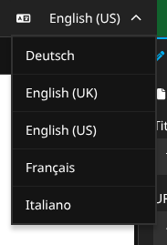
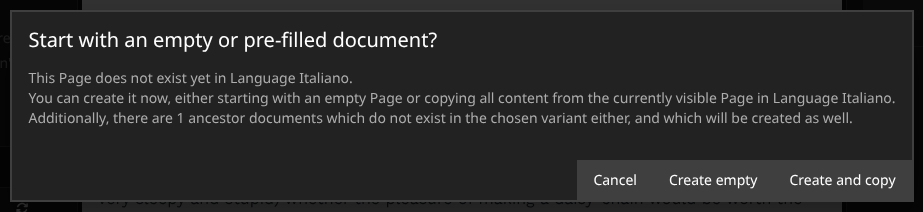
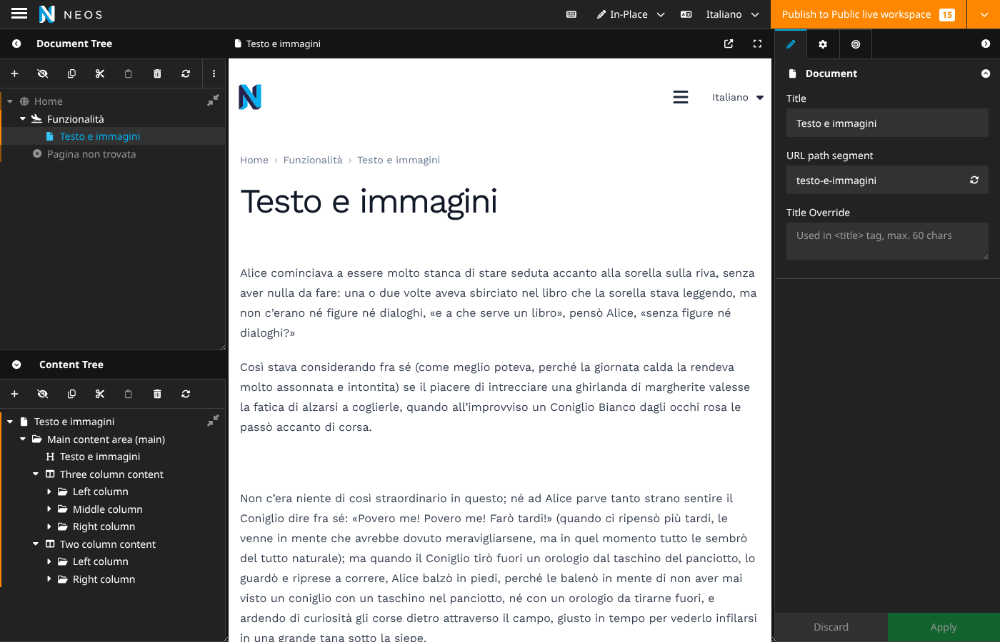
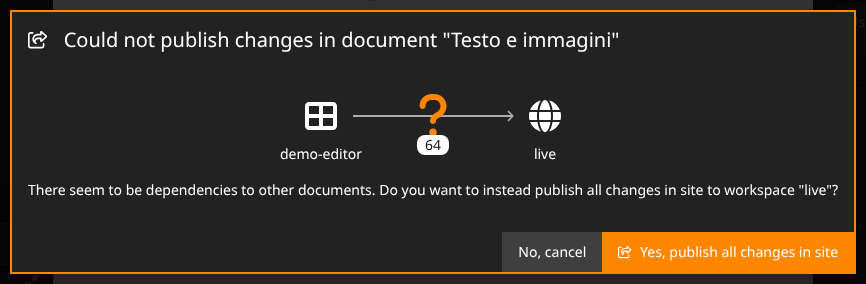
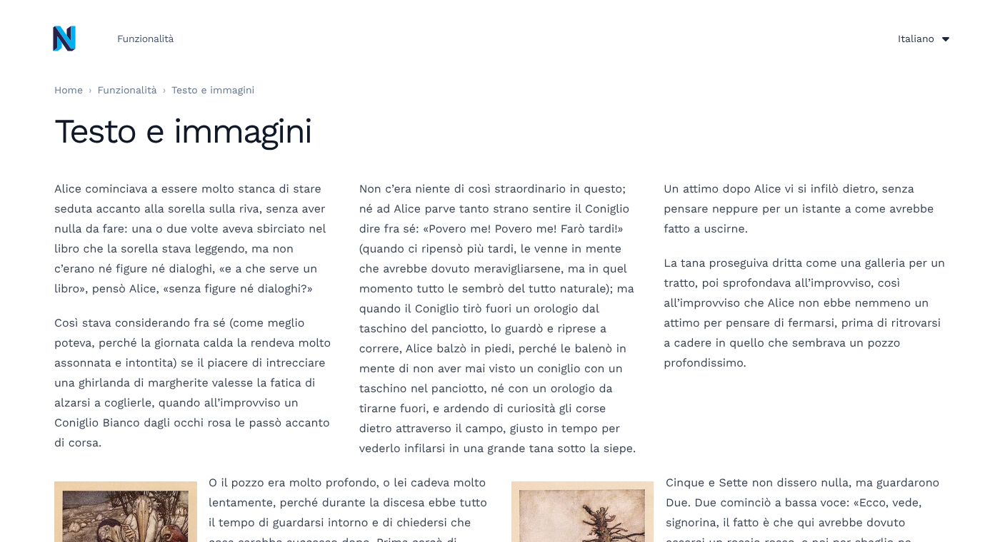
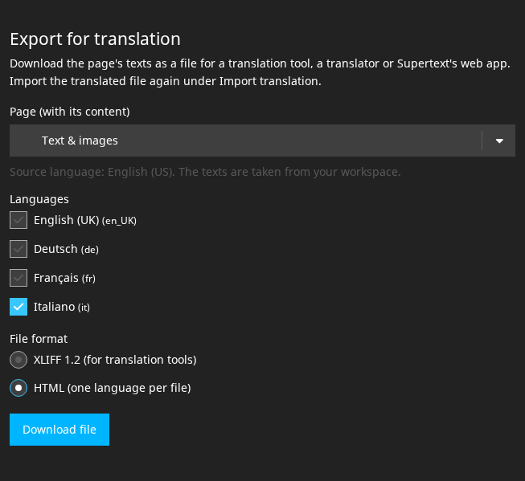
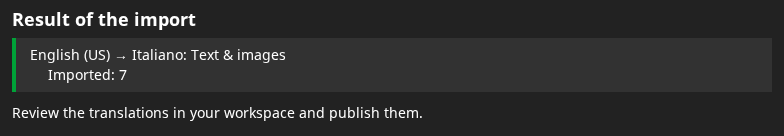

# User guide — Supertext Translation for Neos

For editors. Once an administrator has installed the package (see [INSTALLATION.md](INSTALLATION.md)), you translate pages exactly as you always do in Neos: switch the language and create the page. Supertext fills in the text.

## Translate a page

1. In the Neos backend, select the page in the **Document Tree**.
2. Open the **language menu** in the top bar and choose the target language.

   

3. If the page doesn't exist in that language yet, Neos asks how to start:

   

   - **Create and copy** — creates the page with all its content and translates everything: page title, headlines, text, image captions and so on. This is what you usually want.
   - **Create empty** — creates the page without content. Only the page's own fields (title, SEO texts) are translated.

   If parent pages are missing in that language too, Neos creates them as well, and they are translated in the same go.

4. Wait a moment. The whole page goes to Supertext as one request, typically a few seconds, longer for very long pages. Neos then shows the page in the new language, already translated:

   

## Review and publish

The translation lands in **your own workspace**, like any other change: visitors don't see it until you publish. Read through it, correct anything you like directly on the page, then publish:

The first time you translate into a language, Neos also created the parent pages (e.g. *Home*) in that language. Publishing only the current page then isn't possible, and Neos offers to publish all your changes instead. Choose **Yes, publish all changes in site** (and confirm), or review the other pages first.

After publishing, the page is live in the new language:

**Translation review:** if your administrator turned on *Translation review* for a language, reviewers (your colleagues or Supertext linguists) check and correct the translations on the website. Their corrections come into Neos the next time a page is translated into that language: after a review, translate it again. Texts reviewed once keep their corrected wording in later translations.

## What gets translated

- Everything you can edit directly on the page (headlines, text, rich text), with its formatting and links kept.
- Text fields in the Inspector: page title, SEO title and description, image alt texts and titles, and similar.
- The page's **URL path segment** is rebuilt from the translated title (e.g. *Testo e immagini* → `testo-e-immagini`).
- Pages translated as a whole: content elements inside columns and other containers are included.

## What is *not* translated

- Content you add to the source page **after** the page was translated. Add it in the target language yourself.
- Changes to the source page after translating. The translation is a one-time copy; it doesn't follow later edits.
- Images and files themselves, links' targets, dates, numbers, selections (e.g. alignment or heading level), and code/HTML elements.
- Regional variants of the same language, such as *English (UK)* from *English (US)*: Neos copies them as they are.

## Formal and informal language

Your administrator decides per language (under **Administration → Supertext**) which variant Supertext translates into, e.g. Swiss or German German, and whether it writes formally (*Sie*, *vous*, *Lei*) or informally (*du*, *tu*). On the Supertext demo, German, French and Italian are formal.

## When something goes wrong

If Supertext can't translate (for example no API key configured, network problem, quota exceeded), Neos still creates the page and its content in the new language, **as untranslated copies** in the source language. You can translate them by hand, or discard the changes in your workspace and try again later. Your administrator finds the reason in the Neos system log (see the installation guide).

Reasons your administrator may see, and what they mean for you:

| Message | What it means |
| --- | --- |
| *The language … has no Supertext language yet. Ask your administrator to map it …* | Your administrator hasn't told the package yet which Supertext language this Neos language is (e.g. Swiss or German German). Nothing was sent to Supertext. Ask your administrator to map it, then translate again. |
| *Supertext offers no formal or informal tone for this language …* | A formal or informal tone is set for a language that has none (e.g. English). Your administrator sets it back to the default tone. |
| *Supertext rejected the API key* / *No Supertext API key is set* | The connection to Supertext isn't set up correctly. Your administrator fixes the key. |

Translating with *Create and copy* happens in Neos' own interface. The package's one screen of its own, **Management → Supertext** (export and import of translation files, below), follows the interface language set in your user settings (English, German, French or Italian).

## Translation files: export and import (XLIFF or HTML)

Besides translating with Supertext right away, a page can be translated outside Neos: in a translation tool (Trados, memoQ, Phrase …), by a translator, or in Supertext's web app. Open **Management → Supertext** in the Neos menu.

1. **Export for translation:** choose the **Page** (it is exported with its content elements, exactly what *Create and copy* would translate), tick the **Languages** to translate into and choose the **File format**, then click **Download file**. The texts are taken from your workspace in the site's default language (shown under the page), so unpublished changes of yours are included.
   - **XLIFF 1.2 (for translation tools)**: the better choice for translation tools and translators. Formatting (bold, links) is shown as protected tags. Several languages fit in one file.
   - **HTML (one language per file)**: for Supertext's web app or anyone who translates HTML files. Whoever translates it must leave its `<head>` and the `data-st-id` attributes alone: they tell the package which page and which texts they are. An HTML file can't mark a text as untranslated, so an HTML file imported unchanged writes the original (source) text into the translation.

   
2. Send the file to the translator, or upload it to Supertext's web app, and get the translated file back.
3. **Import translation:** choose the translated file (XLIFF or HTML, at most 10 MB; any page, it doesn't have to be the one selected on the left) and click **Import translation**. The translations are written into the language version of the page **in your workspace**. If the page doesn't exist in that language yet, it is created first (like *Create and copy*). Texts whose original was edited after the export are skipped; tick **Also import texts whose source changed since the export** to import them anyway.
4. Review and publish as described above: the imported page shows up as a change in your workspace.

The import shows a summary per page and language:

| Line | Meaning |
| --- | --- |
| *Imported: N* | Texts written into the translation. |
| *Skipped, source changed since the export: N* | The original text was edited after the export. Import again with *Also import texts whose source changed since the export* ticked, or export again. |
| *Not translated in the file: N* | The file has no translation for these texts. |
| *Formatting changed, not imported: N* | The translation broke or added formatting (tags) the original doesn't have. Fix it in the file and import again. |
| *Not in the file: N* | Texts added to the page since the export. Export again to translate them. |

| Message | What it means |
| --- | --- |
| *This file isn't a valid XLIFF or HTML translation file.* | Not an XLIFF or HTML file, or damaged. |
| *This file wasn't exported by the Supertext package, or its header was removed.* | The file has no Supertext information (e.g. an HTML file whose `<head>` was removed). |
| *The file is too large (at most 10 MB).* | Split the work into smaller files. |
| *This file belongs to another system (…).* | The file was exported by a Supertext plugin for another CMS. |
| *The page this file was exported from no longer exists.* | The original page or element was deleted. |
| *The site has no language ….* | The language was removed from the site's language dimension. |
| *Nothing to translate.* (export) | The page has no text to translate. |
| *Choose at least one language (exactly one for HTML).* (export) | Tick a language; for HTML, tick exactly one. |
| *Choose a file to import.* | Click **Import translation** after choosing a file. |

Administrators can do the same on the command line (`./flow supertext:export`, `./flow supertext:import`, see the installation guide); the messages there are in English.

## Tips

- Translate a page at once with *Create and copy* rather than element by element: it's one request to Supertext, and the context makes the translation more consistent.
- Start at the top: translate the home page first, then its subpages. Each page then only creates itself in the new language.
